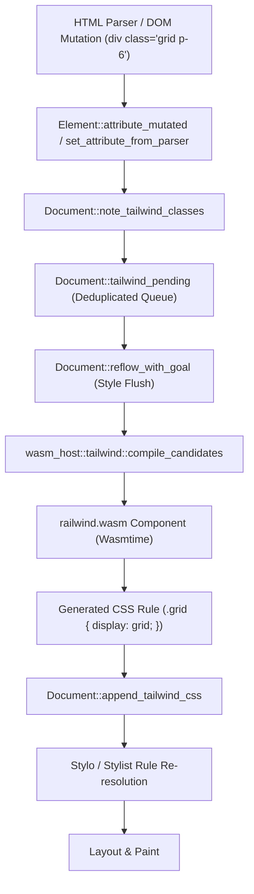

# Railwind

A zero-dependency, WebAssembly Component Model Tailwind CSS JIT compiler designed for first-class integration into the Servo browser engine.

Railwind eliminates the need for Node.js, npm, and PostCSS build pipelines. It compiles utility class candidates directly into standard CSS in-memory inside the browser engine using Wasmtime and the WebAssembly Component Model (`wasm32-unknown-unknown`).

---

## Key Features

- **Zero JavaScript Build Step**: No PostCSS, no Node.js, and no bundler required.
- **Pure-Functional Component**: Implements the `servo:tailwind@0.1.0` WIT contract with **zero host imports**, ensuring complete sandboxing, instant instantiation, and zero runtime host dependencies.
- **Minimal Binary Footprint**: Clean-room implementation in pure Rust with no heavy parser crates (`cssparser` removed), yielding a sub-50KB Wasm component.
- **Dynamic DOM Integration**: Cooperates with Servo to intercept class tokens during initial HTML parsing (`Element::set_attribute_from_parser`) and dynamic JavaScript runtime mutations (`Element::attribute_mutated`).
- **Lazy Reflow JIT Compilation**: Uncompiled classes are staged in a document-level pending queue and lazily compiled via `railwind.wasm` just before reflow and style resolution, immediately injecting stylesheets into Stylo.

---

## Architectural Workflow in Servo



---

## WIT Interface Contract

Railwind conforms to the `servo:tailwind@0.1.0` WebAssembly Component specification:

```wit
package servo:tailwind@0.1.0;

interface compiler {
    /// Compiles a space-delimited string of classes into a CSS stylesheet.
    compile-classes: func(classes: string) -> string;

    /// Compiles a list of individual class candidate tokens into a CSS stylesheet.
    compile-candidates: func(candidates: list<string>) -> string;
}

world tailwind {
    export compiler;
}
```

---

## Building the Component

### Prerequisites

Install `cargo-component` and the WebAssembly WASI target:

```bash
cargo install cargo-component --locked
rustup target add wasm32-unknown-unknown
```

### Build Command

Compile the release WebAssembly Component:

```bash
cargo component build --release --target wasm32-unknown-unknown
```

The resulting component binary is generated at:
`target/wasm32-unknown-unknown/release/railwind.wasm`

---

## Integration with Servo

### 1. Deploy the Component Binary

Copy the compiled component into Servo's root working directory:

```bash
cp target/wasm32-unknown-unknown/release/railwind.wasm /home/tannal/tannalwork/projects/servo/railwind.wasm
```

### 2. Enable in Servo

Run Servo with the `--pref dom_wasm_tailwindcss_enabled` flag:

```bash
cd /home/tannal/tannalwork/projects/servo
./mach run --pref dom_wasm_tailwindcss_enabled test_wasm.html
```

---

## Host Integration Reference

To invoke Railwind from any Rust host via Wasmtime:

```rust
use wasmtime::Store;
use wasmtime::component::{Component, Linker};

wasmtime::component::bindgen!({
    world: "tailwind",
    path: "wit/railwind.wit",
});

fn main() -> wasmtime::Result<()> {
    let engine = wasmtime::Engine::default();
    let linker = Linker::new(&engine);

    let component_bytes = std::fs::read("railwind.wasm")?;
    let component = Component::from_binary(&engine, &component_bytes)?;

    let mut store = Store::new(&engine, ());
    let instance = Tailwind::instantiate(&mut store, &component, &linker)?;

    let candidates = vec![
        "flex".to_string(),
        "items-center".to_string(),
        "p-6".to_string(),
        "bg-white".to_string(),
        "rounded-2xl".to_string(),
        "shadow-lg".to_string(),
    ];

    let css = instance
        .servo_tailwind_compiler()
        .call_compile_candidates(&mut store, &candidates)?;

    println!("Generated CSS:\n{}", css);
    Ok(())
}
```

---

## Supported Utility Scale

| Category | Supported Utilities |
| :--- | :--- |
| **Display** | `flex`, `inline-flex`, `grid`, `inline-grid`, `block`, `inline-block`, `hidden`, `overflow-hidden`, `object-cover` |
| **Flexbox & Grid** | `items-center`, `items-start`, `items-end`, `justify-between`, `justify-center`, `justify-start`, `gap-*`, `space-x-*` |
| **Sizing** | `w-full`, `h-full`, `w-screen`, `h-screen`, `max-w-sm`, `max-w-md`, `max-w-lg`, `max-w-xl`, `w-*`, `h-*` |
| **Spacing** | `p-*`, `px-*`, `py-*`, `pt-*`, `pb-*`, `pl-*`, `pr-*`, `m-*`, `mx-*`, `my-*`, `mt-*`, `mb-*` |
| **Colors** | `bg-*`, `text-*`, `border-*` (full scales for slate, gray, indigo, blue, red, green, black, white) |
| **Typography** | `text-xs` through `text-3xl`, `font-bold`, `font-semibold`, `font-medium`, `leading-snug`, `leading-tight`, `leading-none` |
| **Borders & Radii** | `border`, `border-t`, `border-b`, `rounded`, `rounded-full`, `rounded-sm` through `rounded-3xl` |
| **Shadows** | `shadow-sm`, `shadow`, `shadow-md`, `shadow-lg`, `shadow-xl` |
| **Transitions** | `transition-all`, `transition-colors`, `duration-300`, `translate-y-*` (including negative `-translate-y-1`) |
| **Variants** | `hover:`, `focus:`, `active:`, `disabled:`, `sm:`, `md:`, `lg:`, `xl:`, `dark:` |

---

## License

This project is licensed under the Mozilla Public License 2.0 (MPL-2.0).
